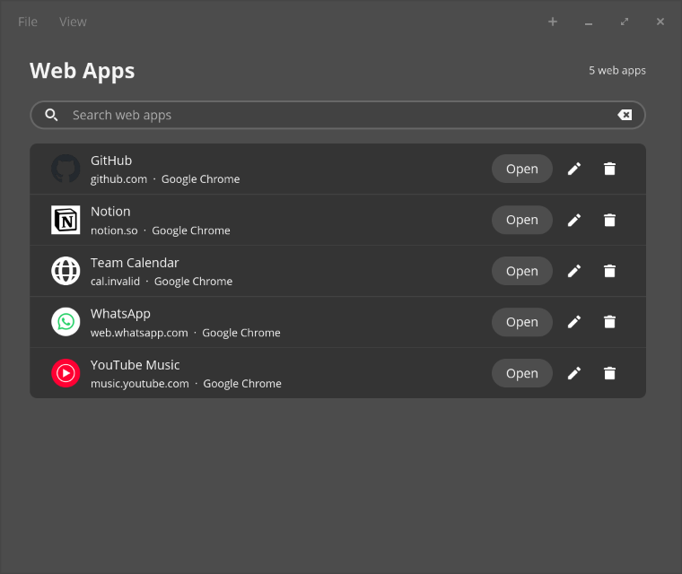

# Web Apps

A small app for the COSMIC desktop that turns websites into web apps. Each web
app gets its own launcher in your app menu and opens the site in its own
browser window, without tabs or an address bar, with the site's icon.



Supported browsers: Google Chrome, Chromium, Brave, Vivaldi and Microsoft
Edge (anything that understands `--app=<url>`). The app lists the ones it
finds on your `PATH`.

## Build and run

You need a Rust toolchain (edition 2024) and the system libraries
[libcosmic](https://github.com/pop-os/libcosmic) builds against.

```sh
cargo run -p webapp-manager      # the app
cargo test                       # the core library's tests
```

A plain `cargo build` builds only the core library. Add `-p webapp-manager` to
build the app.

To install it for your user:

```sh
cargo build --release -p webapp-manager
install -Dm755 target/release/webapp-manager ~/.local/bin/webapp-manager
install -Dm644 app/resources/dev.tsubaie.WebApps.desktop \
  ~/.local/share/applications/dev.tsubaie.WebApps.desktop
```

## How it works

- Each web app is a `.desktop` file at
  `$XDG_DATA_HOME/applications/webapp-<id>.desktop` (by default
  `~/.local/share/applications`). Its icon goes in
  `$XDG_DATA_HOME/webapp-manager/icons/`.
- The app lists, edits and deletes only the launchers it wrote itself, which
  carry `X-WebApp-Manager=true`. It never touches launchers made by browsers or
  other tools.
- If you don't pick an image, the app downloads the site's own icon: the best
  `<link rel="icon">`, then `/apple-touch-icon.png`, then `/favicon.ico`.
- Only `http://` and `https://` addresses are accepted. A bare `example.com`
  becomes `https://example.com`.
- "Open" runs the launcher with `gio launch`. After each change the app runs
  `update-desktop-database` if it is installed.

## Layout

| Path | What it is |
|------|------------|
| `core/` | `webapp-core`: reads and writes launchers, validates input, fetches icons. No UI. |
| `app/` | `webapp-manager`: the COSMIC window. |
| `core/examples/` | Dev helpers: `add` (add one web app from the command line), `seed` (fill a scratch folder with samples), `fetch_icon` (try icon fetching on a URL). |

```sh
cargo run -p webapp-core --example add -- "GitHub" github.com brave
cargo run -p webapp-core --example seed -- /tmp/webapps-test
```

## License

MIT, see [LICENSE](LICENSE).
